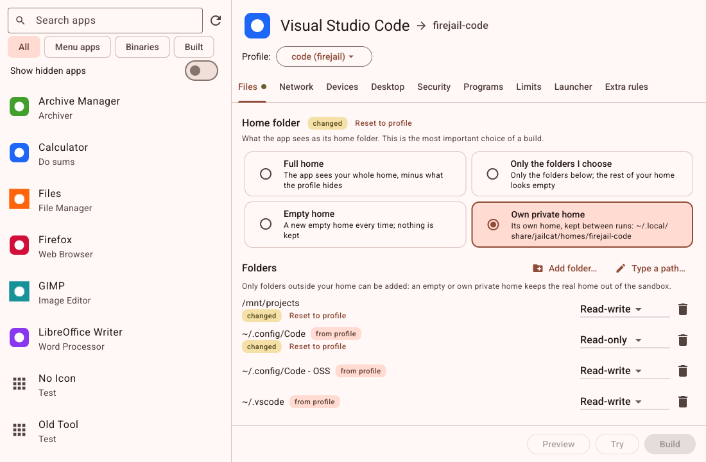

# Jailcat

<p align="center">
  
</p>

Jailcat is a desktop app for [firejail](https://firejail.wordpress.com/). It lists every application you can start (the ones in your application menu and every program on your `$PATH`), lets you choose what a sandboxed copy of one may see and do, and installs that copy under a new name, `firejail-<app>`, in your application menu and in `~/.local/bin`. The sandboxed copy gets the app's own icon with a small jail-bar badge, so you can tell it from the original.



It is written in Go with [Glutter](https://github.com/rm4n0s/glutter) for the window and SQLite for its data. Linux only.

## Install

You need Go 1.27 or newer, a C compiler (`gcc`, for SQLite) and firejail:

```
go install github.com/rm4n0s/jailcat/cmd/jailcat@latest
jailcat -setup-desktop     # optional: puts Jailcat itself in your application menu
jailcat
```

Jailcat never needs root and never writes outside your own folders.

## How it works

1. **Pick an app** from the list on the left. Search it by name or program, or filter menu apps, binaries, or the ones you built.
2. **Pick a profile.** Jailcat starts from firejail's own profile for that app when firejail has one (for VS Code, `code.profile`), else from firejail's `default.profile`. You can choose **None** to start from nothing, any other firejail profile, or import your own.
3. **Change what you want**, tab by tab: the home folder and which folders the app sees (read-write, read-only or hidden), network, devices, the desktop bus, security switches, programs, limits, the launcher, and extra firejail lines. Every field shows the profile's value until you change it; a dot on a tab and a "changed" mark on a field show what you changed, and **Reset to profile** undoes it.
4. **Preview** the files, **Try** the sandbox without installing anything, then **Build**.

A build writes four files and, if you chose one, a private home:

| File | Where |
|---|---|
| The profile: your changes, then `include` of the profile you chose | `~/.local/share/jailcat/profiles/firejail-<app>.profile` |
| The launcher, for bash | `~/.local/bin/firejail-<app>` |
| The menu entry | `~/.local/share/applications/firejail-<app>.desktop` |
| The icon | `~/.local/share/icons/hicolor/scalable/apps/firejail-<app>.svg` |
| Own private home | `~/.local/share/jailcat/homes/firejail-<app>/` |
| VS Code only: its own data folder | `~/.local/share/jailcat/appdata/firejail-<app>/` |

A sandboxed VS Code gets a data folder of its own (`--user-data-dir`): VS Code runs one instance per data folder, and without its own the sandboxed `code` would hand its window to your already-open VS Code, outside the sandbox. Your settings, keybindings and snippets are shared with it through links, and for the integrated terminal your shell startup files are shown read-only (note that what they export, such as API keys, is visible in the sandbox). The three switches are on the Files tab.

Your changes are written as firejail lines placed before the `include`, using firejail's own `ignore` mechanism to undo lines of the profile, so firejail's updates to that profile still reach your sandbox. The sandbox needs only firejail to run: it keeps working if Jailcat is closed or removed. Jailcat never overwrites a file it didn't make, and **Uninstall** removes only the files it wrote.

## Development

`CLAUDE.md` has the commands and rules, `docs/SPEC.md` is the specification, and `docs/IMPLEMENTATION.md` with `docs/IMPLEMENTED.md` is the plan and its log, with a proof screenshot for each step.

```
go test -race ./...                          # everything that needs no firejail
go test -tags jailcat_firejail ./...         # runs the real firejail (not from inside another sandbox)
```

## License

BSD 3-Clause, see [LICENSE](LICENSE).
