# Implemented steps

This is the log of finished steps from `docs/IMPLEMENTATION.md`, newest at the bottom. The manager adds an entry on the step's branch, as part of the step's commit (`docs/IMPLEMENTATION.md`, rules 10–12). The next step to do is the first step in `docs/IMPLEMENTATION.md` that has no entry here.

## Entry format

Copy this block, fill it in, and keep every heading. Write "none" where something doesn't apply.

```markdown
## <id> <step title>

- **Date:** YYYY-MM-DD
- **Branch:** feat/step-<id>-<slug>
- **Summary:** 2–4 sentences on what now exists and works.
- **Main files:** the packages or files created or changed.
- **Tests:** what was added.
- **Checks:** gofmt ✅ · go vet ✅ · golangci-lint ✅ · go test -race ✅ · firejail tests ✅/none · display tests ✅/none
- **Proof:**
  
  One sentence describing what the image shows, as you verified it by viewing it.
- **Manual checks:** the user's answers to the step's manual checks, or "none".
- **Deviations and follow-ups:** differences from SPEC (also changed in SPEC), and TODOs left for later steps.
```

---

<!-- Entries start below this line. -->

## 0.1 Module, layout and docs

- **Date:** 2026-10-27
- **Branch:** feat/step-0.1-module-layout-docs
- **Summary:** The Go module `github.com/rm4n0s/jailcat` (go 1.27) exists with Glutter v1.9.0, rm4n0s/errors v0.2.0, GORM v1.31.2 and its SQLite driver v1.6.0. Every package of CLAUDE.md "Layout" has a `doc.go` naming the SPEC sections it implements. CLAUDE.md, the SPEC, this plan and the lint config are committed.
- **Main files:** `go.mod`, `go.sum`, `cmd/jailcat/main.go`, `internal/*/doc.go`, `assets/README.md`, `.gitignore`, `.golangci.yml`, `CLAUDE.md`, `docs/SPEC.md`, `docs/IMPLEMENTATION.md`, `docs/IMPLEMENTED.md`.
- **Tests:** none (no code yet).
- **Checks:** gofmt ✅ · go vet ✅ · golangci-lint ✅ · go test -race ✅ · firejail tests none · display tests none
- **Proof:** none
- **Manual checks:** none
- **Deviations and follow-ups:** `cmd/jailcat/main.go` holds the four dependencies with blank imports so `go mod tidy` keeps them; step 4.1 replaces them with real use.

## 1.1 Folders (`internal/xdg`)

- **Date:** 2026-10-27
- **Branch:** feat/step-1.1-folders
- **Summary:** `internal/xdg` resolves every folder of SPEC §3.1 from an `Env` that is passed in (`FromOS` is the only reader of the process environment), with the XDG rule that unset, empty or relative values fall back to defaults. Firejail's user config folder is always `$HOME/.config/firejail`, and the user-folder macros (`${DOWNLOADS}`, …) resolve exactly as firejail 0.9.80's `macros.c` does. `EnsureDirs` creates Jailcat's own folders with the modes of §3.1; `OnPath` says whether the bin folder is on `$PATH`.
- **Main files:** `internal/xdg/env.go`, `dirs.go`, `userdirs.go`, `ensure.go`, `onpath.go`, `xdg_test.go`, `umask_test.go`; `docs/SPEC.md` §3.1 and §8.1.
- **Tests:** table tests for `Resolve` (set, unset, empty, relative variables; `XDG_DATA_DIRS`; `XDG_BIN_HOME`; firejail's folder under `$HOME`), `UserDirs` (user-dirs.dirs cases, firejail's translations, prefix match, `XDG_CONFIG_HOME` ignored), `EnsureDirs` (modes under umask 077, existing modes kept, Bin/Applications/Icons not created), `OnPath`; route tests for all 9 tags.
- **Checks:** gofmt ✅ · go vet ✅ · golangci-lint ✅ · go test -race ✅ · firejail tests none · display tests none
- **Proof:** none
- **Manual checks:** none
- **Deviations and follow-ups:** SPEC §3.1 corrected: firejail ignores `$XDG_CONFIG_HOME` (`profile.c` builds `$HOME/.config/firejail`), and §8.1 now says how firejail resolves the user-folder macros. `Dirs` also has `Launchers` (`<data>/launchers`, SPEC §9.3). An unreadable `user-dirs.dirs` is an error (`UserDirsReadFailed`) where firejail would ignore it.

## 1.2 Desktop entries (`internal/desktopentry`)

- **Date:** 2026-10-27
- **Branch:** feat/step-1.2-desktop-entries
- **Summary:** `internal/desktopentry` reads and writes `.desktop` files by the Desktop Entry Specification: groups and keys in file order with comments kept, localized lookup in the spec's order, string and list escapes, booleans, actions in `Actions=` order, and desktop file IDs. `SplitExec`, `QuoteExecArg` and `JoinExec` handle the `Exec` key's quoting and field codes. Every one of the 210 real entries in `/usr/share/applications` parses and its `Exec` lines split (checked once by the manager, not a test).
- **Main files:** `internal/desktopentry/entry.go`, `parse.go`, `write.go`, `value.go`, `exec.go`, `fileid.go`, their tests, and `testdata/` (VS Code, Firefox, quoted-Exec, comment and CRLF fixtures, 7 broken files, a golden built entry).
- **Tests:** parsing of every fixture and error case; localized lookup order; lists and booleans; `Exec` round trips over every reserved character, `%`, newline, non-ASCII and the empty argument; byte-identical write round trips; route tests for all 18 tags. 100% statement coverage.
- **Checks:** gofmt ✅ · go vet ✅ · golangci-lint ✅ · go test -race ✅ · firejail tests none · display tests none
- **Proof:** none
- **Manual checks:** none
- **Deviations and follow-ups:** `JoinExec` returns `(string, error)` (an unlisted field code is refused). A repeated key in a group is an error (`DuplicateKey`), as the spec says; a file that fails to parse is skipped by step 1.3. A newline in an `Exec` argument is written inside quotes and escaped as `\n`. Deprecated field codes are dropped on reading.

## 1.3 Finding apps (`internal/apps`)

- **Date:** 2026-10-27
- **Branch:** feat/step-1.3-finding-apps
- **Summary:** `apps.Scan` lists every app of SPEC §4: desktop entries from the user and system `applications` folders (first folder wins for an ID, `Hidden`, `NoDisplay`, `TryExec`, Jailcat's own entries dropped), with the binary resolved through `env`, firejail wrappers, Flatpak, Snap and firecfg symlinks, and every executable on `$PATH` not already run by an entry. Dropped entries come back in `Skipped` with a reason. `Search` filters and orders the list (§4.3). On this machine (checked once by the manager) it finds 202 desktop apps and 3,329 binaries, and the 20 skipped entries are real faults (missing binaries, no `Exec`).
- **Main files:** `internal/apps/apps.go`, `desktop.go`, `command.go`, `lookup.go`, `binaries.go`, `search.go`, their tests, `testdata/fake/` (43 desktop fixtures).
- **Tests:** the whole fake system (shadowed and hidden IDs, every `Exec` form, firecfg symlink shadowing, `$PATH` order, actions, locales, unreadable folders); `LocaleFromEnv`; `Search` fields, ordering, filters; the `ScanCancelled` route test.
- **Checks:** gofmt ✅ · go vet ✅ · golangci-lint ✅ · go test -race ✅ · firejail tests none · display tests none
- **Proof:** none
- **Manual checks:** none
- **Deviations and follow-ups:** an unknown `env` option (`-S`, `-C`) drops the entry instead of guessing; a Snap path is not checked for existence; an entry with no `Name` falls back to the binary name; the Flatpak and Snap launchers themselves stay in the binaries list.

## 1.4 Finding icons (`internal/icons`, lookup part)

- **Date:** 2026-10-27
- **Branch:** feat/step-1.4-icon-lookup
- **Summary:** `icons.Lookup` finds an app's icon by the Icon Theme Specification: absolute paths as they are, then the theme chain (`Inherits`, ending in `hicolor`), scalable SVG first, else the largest fixed size with SVG before PNG, then unthemed files and `pixmaps`; XPM only when nothing else exists. `CurrentTheme` reads the theme name from GTK 4, GTK 3 or KDE settings files. On this machine (checked once by the manager) Firefox gets hicolor's 256px PNG and breeze's own SVGs are found through its `index.theme`.
- **Main files:** `internal/icons/theme.go`, `lookup.go`, `current.go`, `ini.go`, their tests, `testdata/fake/` (themes `Test` → `Parent` → `hicolor`, a loop, settings files).
- **Tests:** absolute paths, theme chains and loops, size and format order, XPM and pixmaps fallbacks, `CurrentTheme` sources, I/O failures and cancellation; route tests for the 6 tags. 98.8% coverage.
- **Checks:** gofmt ✅ · go vet ✅ · golangci-lint ✅ · go test -race ✅ · firejail tests none · display tests none
- **Proof:** none
- **Manual checks:** none
- **Deviations and follow-ups:** pixmaps are searched in `<each XDG data dir>/pixmaps` rather than only `/usr/share/pixmaps` (the same folder by default). The first theme in the chain that has the icon wins, even if a parent has a larger one. `LoadTheme`, `BaseDirs` and `PixmapDirs` are exported for the UI.

## 2.1 Reading profiles (`internal/firejail`, reader)

- **Date:** 2026-10-27
- **Branch:** feat/step-2.1-profile-reader
- **Summary:** `firejail.Read` reads a profile and its include chain the way firejail 0.9.80's `profile_read` and `profile_check_line` do: `fgets` chunking, comment and blank normalization (`line_remove_spaces`), include resolution and the depth limit, the ignore list with `is_in_ignore_list`'s matching and the 32-entry limit, every conditional with its real trigger, `quiet`, and the lines firejail makes itself (`whitelist-ro`, `noprinters`). Every rule names the C function it follows. `ReadConfig` reads `firejail.config`; `Commands` lists the 129 profile commands.
- **Main files:** `internal/firejail/profile_line.go`, `profile_read.go`, `profile_config.go`, `profile_commands.go`, their tests, `testdata/etc-firejail/` (16 files copied unchanged from `/etc/firejail`, GPL-2.0, with a README).
- **Tests:** `Normalize` and `Matches` tables; the real `code.profile` chain (effective lines, ignore entries, the ignored `dbus-user none` and `disable-xdg.inc`, missing `.local` files); user-folder precedence; every conditional and its ordering; 32 vs 33 ignores; include depth and cycles; `ReadConfig`; route tests for the 15 tags. 98.8% coverage.
- **Checks:** gofmt ✅ · go vet ✅ · golangci-lint ✅ · go test -race ✅ · firejail tests none · display tests none
- **Proof:** none
- **Manual checks:** none
- **Deviations and follow-ups:** SPEC §8.1 corrected from firejail's source: only missing `.local` includes are skipped, there is a depth limit instead of a cycle check, `whitelist-ro` and `noprinters` make lines no `ignore` can remove, and the conditionals' triggers are listed. §9.1 says rows from `whitelist-ro` are locked; §7.2 allows four DNS servers. `keep-hostname` (a removed command) is not in the command list. A bare include name is not looked up in the working directory, which firejail does as a last resort.

## 2.2 Settings and base values (`internal/firejail`, model)

- **Date:** 2026-10-27
- **Branch:** feat/step-2.2-settings-model
- **Summary:** `Settings` holds every setting of SPEC §7, and a field table (`Fields()`) gives each one its tab, getter, setter and equality, so diffing, applying, JSON and tests are built on it. `BaseValues` maps a read profile to settings, keeping the base lines behind each value (for step 2.3's `ignore` lines), the folder rows of the `.profile` and `.local` files, and the uncovered lines grouped by file. `Overrides` stores only what the user changed, as versioned JSON that keeps fields it doesn't know. `Validate` returns the problems the UI shows.
- **Main files:** `internal/firejail/settings.go`, `fields.go`, `base.go`, `overrides.go`, `validate.go`, their tests.
- **Tests:** the VS Code chain field by field (sound, camera, U2F, DVD, input, TV blocked; private `/dev`, `/tmp`, cache; firewall from `blink-common.profile`; five folder rows; no seccomp, nonewprivs or noroot, since Electron runs its own sandbox), `default.profile`, about 75 per-command cases, diff/apply round trips generated from the field table, folder overrides with locked rows, JSON with unknown fields, every validation rule; route tests for the 4 tags.
- **Checks:** gofmt ✅ · go vet ✅ · golangci-lint ✅ · go test -race ✅ · firejail tests none · display tests none
- **Proof:** none
- **Manual checks:** none
- **Deviations and follow-ups:** `BaseValues` takes the home path as a second argument. Folder rows come from `.profile` and `.local` files; system folders and globs go to the read-only list (SPEC §7.1 updated). Base rows stay with Empty and Own private home, where `${HOME}` is the private home (SPEC §7.1). From firejail's source: `protocol` lines merge with `+`/`-`/`=`, `cpu` takes 0–31, `nice` is clamped to 0 for non-root, `rlimit-as` takes K/M/G (SPEC §7.7 updated). Launcher fields never come from a profile except `join-or-start`.

## 2.3 Writing profiles (`internal/firejail`, writer)

- **Date:** 2026-10-27
- **Branch:** feat/step-2.3-profile-writer
- **Summary:** `Generate` writes the profile of SPEC §9.1 from a base, overrides and Extra rules: for every field whose final value differs from what the `include` alone gives, it cancels the base lines behind it with `ignore` and writes the final value's lines; positive lines come before the ignores, base lines an `ignore` would hit by accident are written again above it, the 32-ignore limit is counted with the base chain, and Own private home adds `ignore mkdir`/`ignore mkfile`. Every value goes through one escaping function. `CheckExtraRules` checks the Extra rules rows with errors and warnings.
- **Main files:** `internal/firejail/header.go`, `writer.go`, `writer_lines.go`, `writer_value.go`, `extrarules.go`, `validate.go` (Severity, Row, two problems), their tests, `testdata/profiles/` (10 golden profiles); `docs/SPEC.md` §9.1.
- **Tests:** the round trip (generate → read with step 2.1's reader → base values → equal to the edited settings) for every field over 8 bases, every home mode with every folder-row kind, and seeded random combinations; the mutation check (removing the cancel, the rewrite or the shared-line handling makes it fail); golden profiles reviewed line by line by the manager; over-matching, `whitelist-ro`, `noprinters`, conditionals, the ignore limit, every escaping error, about 120 Extra-rules rows; route tests for all 14 tags.
- **Checks:** gofmt ✅ · go vet ✅ · golangci-lint ✅ · go test -race ✅ · firejail tests none (step 3.4) · display tests none
- **Proof:** C: the golden profiles `internal/firejail/testdata/profiles/code-changes.profile`, `code-home-private.profile`, `code-over-matching.profile` and `none-defaults.profile`.
- **Manual checks:** none
- **Deviations and follow-ups:** the file order is now positive lines, then `ignore` lines, then Extra rules, then `include` (SPEC §9.1 updated). A base conditional line that Jailcat's changes would turn false is written again without its condition; a false one that becomes true is left to firejail. `private-cache` also acts on the real home under `private DIR` (man page), but only as a mount inside the sandbox, so nothing is written for it. Chosen home without any `whitelist` under the home is refused.

## 2.4 Launcher script (`internal/firejail`, launcher)

- **Date:** 2026-10-27
- **Branch:** feat/step-2.4-launcher
- **Summary:** `WriteLauncher` writes the launcher of SPEC §9.2 with the shared header: `exec` of firejail's absolute path, `--profile=…`, `--`, the binary, the extra arguments and `"$@"`, every word through `ShellQuote` (POSIX single quotes; NUL refused). `FindFirejail` finds firejail on `$PATH`, and `Version` reads `firejail --version` with a 5-second limit.
- **Main files:** `internal/firejail/shellquote.go`, `launcher.go`, `find.go`, their tests, `testdata/launchers/` (4 golden launchers).
- **Tests:** `ShellQuote` table; golden launchers byte for byte, each passing `sh -n`; a behaviour test where a fake firejail prints its arguments NUL-separated and every user argument (spaces, quotes, `$HOME`, `*`, newline, empty, `--`) arrives unchanged and in order; `FindFirejail` and `Version` cases with fake scripts; route tests for the 9 tags.
- **Checks:** gofmt ✅ · go vet ✅ · golangci-lint ✅ · go test -race ✅ · firejail tests none (step 3.4) · display tests none
- **Proof:** C: `internal/firejail/testdata/launchers/special-args.sh`.
- **Manual checks:** none
- **Deviations and follow-ups:** `--` is written unquoted, as in SPEC §9.2. Only Jailcat's own 5-second limit counts as a version timeout; a cancelled caller context is `FirejailVersionFailed`.

## 3.1 Building icons (`internal/icons`, writer)

- **Date:** 2026-10-27
- **Branch:** feat/step-3.1-building-icons
- **Summary:** `BadgeIcon` writes a build's 128×128 SVG icon: the app's SVG (parsed, sanitized by an element allowlist, ids prefixed and references rewritten) or PNG (embedded as a data URI) as a nested `<svg>`, with the jail-bar badge at the bottom-right. KDE's colour-scheme `<style>` rules are applied as attributes, so breeze icons keep their colours. `RandomIcon` draws a seeded shape, gradient and initial with the badge. The badge and Jailcat's own icon are hand-written SVGs in `assets/`.
- **Main files:** `assets/badge.svg`, `assets/jailcat.svg`, `assets/embed.go`; `internal/icons/compose.go`, `sanitize.go`, `cssclass.go`, `svgnode.go`, their tests, `testdata/compose/`.
- **Tests:** byte-for-byte golden SVGs (simple, ids/gradients/`use`, hostile, PNG, VS Code-like, breeze, size-only, three random), each rendered by `rsvg-convert` without warnings; pixel checks of the colour-scheme rules and their precedence; 26 hostile `<style>` blocks dropped; refused sources (XPM, DTD entities, oversize, deep nesting, fake PNG); determinism; contrast of the random palette; route tests for the 3 tags.
- **Checks:** gofmt ✅ · go vet ✅ · golangci-lint ✅ · go test -race ✅ · firejail tests none · display tests none
- **Proof:**
  
  A blue rounded square with a white `</>` and the amber jail-bar shield at the bottom-right, viewed by the manager.
  
  Three random icons, a blue circle with F, a teal rounded square with C and a purple hexagon with É, each with the badge, viewed by the manager.
- **Manual checks:** none
- **Deviations and follow-ups:** every icon starts with an XML declaration and Jailcat's header comment (SPEC §9.5's ownership check needs it). Of the system's icons, no hicolor app SVG uses `<style>`; 27% of breeze's do, all in the colour-scheme form now supported (SPEC §10.2 updated). Qt SVG rendering was not checked; only librsvg was available.

## 3.2 Database (`internal/store`)

- **Date:** 2026-10-27
- **Branch:** feat/step-3.2-database
- **Summary:** `internal/store` keeps builds and their installed files in SQLite through GORM, in english-tutor's pattern: the file is created with mode 0600, foreign keys are on for every connection, and the schema comes from numbered migrations with frozen structs (`001_init`). The API hands out plain `Build`, `Draft` and `InstalledFile` values; overrides are stored as firejail's versioned JSON and drafts as one JSON column. `RecordInstall` replaces a build's files in one transaction.
- **Main files:** `internal/store/store.go`, `migrations.go`, `build.go`, `builds.go`, `files.go`, their tests.
- **Tests:** every method on an in-memory and a file database; mode 0600; migrations applied twice; foreign keys on three pooled connections; unique sandbox name and installed path; cascade delete; an atomic `RecordInstall` that fails and keeps the old rows; overrides and drafts round trips; route tests for every tag, firejail's JSON errors passed back unwrapped.
- **Checks:** gofmt ✅ · go vet ✅ · golangci-lint ✅ · go test -race ✅ · firejail tests none · display tests none
- **Proof:** none
- **Manual checks:** none
- **Deviations and follow-ups:** saving or clearing a draft does not change `UpdatedAt`. App kinds, icon modes and file kinds are constants but not checked on write.

## 3.3 Installing (`internal/install`)

- **Date:** 2026-10-27
- **Branch:** feat/step-3.3-installing
- **Summary:** `Prepare` turns a build into its files (profile, launcher, SVG icon with its fallback reason, the desktop entry of SPEC §9.3 with field codes, copied keys, `StartupWMClass` and same-binary actions, and the private home) without writing anything. `Check` classifies every target by SPEC §9.5's ownership rules, `Install` re-checks and writes atomically (temp file, fsync, chmod, rename) with the desktop entry last, and `Uninstall` removes only recorded files that are unchanged, keeping the private home unless asked.
- **Main files:** `internal/install/files.go`, `prepare.go`, `desktop.go`, `check.go`, `install.go`, `uninstall.go`, their tests, `testdata/` (apps, icons, golden texts).
- **Tests:** a whole VS Code-like install into a temp home compared with golden texts; every conflict kind, unconfirmed and confirmed overwrites, a stale plan; icon fallbacks; field codes, actions, localized action names, `StartupWMClass`, `MimeType`, menu and bin switches; the entry parses back; uninstall cases; route tests for all 21 tags. 94% coverage.
- **Checks:** gofmt ✅ · go vet ✅ · golangci-lint ✅ · go test -race ✅ · firejail tests none (step 3.4) · display tests none
- **Proof:** C: `internal/install/testdata/golden/vscode.desktop`, `vscode.sh` (the launcher), `vscode.profile`, reviewed by the manager.
- **Manual checks:** none
- **Deviations and follow-ups:** `Install` takes the owner lookup (it re-runs `Check`); `UninstallOpts` carries `Dirs`. An edited file is overwritable only if it still has Jailcat's header. The main `Exec` keeps only the app's first field code, not its other arguments. An empty menu name is refused when the entry is installed.

## 3.4 Running firejail (Try and the build check)

- **Date:** 2026-10-27
- **Branch:** feat/step-3.4-running-firejail
- **Summary:** `firejail.Runner` runs Try (SPEC §11.2: a temporary profile, `--name=jailcat-try-<name>`, its own process group, streamed output, `Stop` through `--shutdown` then a kill) and the build check (§11.3 step 5: `firejail --profile=… -- true`, with `--ignore=private-bin` for builds with Only these programs). The "existing sandbox" warning is its own tag. Real-firejail tests prove what the installed launchers do: hidden folders are invisible, read-only folders can't be written, Only the folders I choose hides the rest, `net none` leaves `lo`, `ignore` above the `include` undoes a base line, Own private home keeps the base's `mkdir` lines out of the real home, and Try starts and stops a named sandbox.
- **Main files:** `internal/firejail/run.go`, `run_test.go`, `run_firejail_test.go`; `internal/install/firejail_test.go`; `docs/SPEC.md` §11.3.
- **Tests:** unit tests with a fake firejail (argument lists, streaming, stop, cancel, no leftover processes, the ignore-limit skip); route tests for every tag; 13 real-firejail tests (`-tags jailcat_firejail`), run by the manager outside Claude Code's sandbox.
- **Checks:** gofmt ✅ · go vet ✅ (with and without the tag) · golangci-lint ✅ (with and without the tag) · go test -race ✅ · firejail tests ✅ · display tests none
- **Proof:** none
- **Manual checks:** none
- **Deviations and follow-ups:** the check runs without `--quiet`, which would hide the nested-sandbox warning (SPEC §11.3 updated). The private-home probe first failed on `.bashrc` and `.inputrc`: firejail copies `/etc/skel` files into a fresh home (`fs_home.c`, `skel`), so the probe now allows them. The temporary home of the tests cannot be the sandbox's `$HOME` (firejail takes the account's home), so the probes use folders under `/tmp`.

## 4.1 App shell and app list

- **Date:** 2026-10-27
- **Branch:** feat/step-4.1-app-shell
- **Summary:** `go run ./cmd/jailcat` opens Jailcat's window: the app list of SPEC §5 with search, the four filters, Show hidden apps, Refresh, real icons drawn with Glutter's `svg` package (PNG through the image widget, a generic icon otherwise), built marks, "uses firejail" and disabled Flatpak/Snap rows, the firejail-missing banner, and an empty state with Jailcat's icon. Everything slow runs off the UI thread through a `Backend` interface (`LocalBackend` for the real system, a fake in tests). `jailcat -setup-desktop` (SPEC §3.2, the owner's request) puts Jailcat itself in the application menu.
- **Main files:** `cmd/jailcat/main.go`, `main_test.go`; `internal/ui/backend.go`, `localbackend.go`, `app.go`, `home.go`, `applist.go`, `approw.go`, `appicon.go`, their tests, `testdata/`; `internal/install/setup.go`, its tests and golden entry; `scripts/headless-wayland.sh` (from Glutter v1.9.0).
- **Tests:** widget tests with a fake backend (rows, search, filters, built chips, hidden apps, selection, the disabled Flatpak row, scan and builds errors, the banner, every icon fallback); three golden screens; `LocalBackend` on a temp home; `-setup-desktop` golden, quoting of odd paths, a second run replacing the files, and `main`'s exit codes.
- **Checks:** gofmt ✅ · go vet ✅ · golangci-lint ✅ · go test -race ✅ · firejail tests none · display tests none
- **Proof:**
  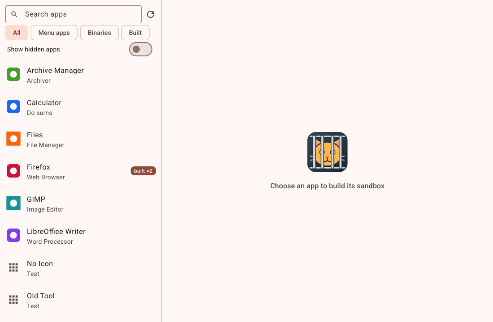
  The fixture app list in the light theme: SVG and PNG icons, generic icons for the icon-less apps, Firefox with "built ×2", and the empty state with Jailcat's caged cat; viewed by the manager.
  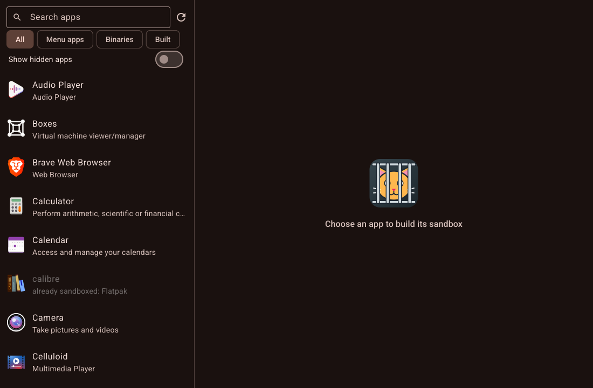
  The real app on a scratch home under a headless compositor (dark theme): the system's apps with their real icons and calibre greyed as an already-sandboxed Flatpak; viewed by the manager.
- **Manual checks:** none
- **Deviations and follow-ups:** with no search text, **All** lists menu apps before binaries (SPEC §4.3 updated). Proof method B uses the XDG variables instead of a dev-home variable. `AppID` lives in `internal/install`. The `-setup-desktop` entry has no Jailcat header and is not a build.

## 4.2 Build editor shell and profile selector

- **Date:** 2026-10-27
- **Branch:** feat/step-4.2-editor-shell
- **Summary:** Selecting an app opens the build editor of SPEC §6: the header (icon, app → sandbox name), the profile selector (a searchable, grouped dialog with Import), the nine tabs with change dots, "changed" marks with Reset to profile, validation problems, and the disabled button bar. An `Editor` model (no widgets) holds base, overrides and Extra rules; switching profile asks Keep my changes / Start over / Cancel. Apps with several builds open a chooser; unsaved changes become drafts when another app is selected or the window closes (Glutter's `OnExitRequested`), and come back with an "Unsaved draft" note and Discard draft. Overrides a newer Jailcat stored survive edits, drafts and profile switches.
- **Main files:** `internal/ui/editor.go`, `editorpage.go`, `tabs.go`, `changedmark.go`, `profiledialog.go`, `dialogs.go`, `profiles.go`, `newbuild.go`, `openeditor.go`, `home_open.go`, `localbackend_editor.go`, their tests; `internal/firejail/fields.go` (`Field.Value`), `overrides.go` (`WithUnknownFrom`).
- **Tests:** `Editor` table tests (set/reset, change dots, profile switches over the VS Code and default fixtures, drafts, unknown keys kept); `LocalBackend` profile choices, base reading, import naming, new-build defaults; widget tests for the editor, the profile dialog, Keep/Start over, the build chooser, drafts on switching apps and on closing the window, Discard draft, import through the fake file chooser; route tests for the 8 tags; goldens `editor`, `editor-files`, `profile-selector`.
- **Checks:** gofmt ✅ · go vet ✅ · golangci-lint ✅ · go test -race ✅ · firejail tests none · display tests none
- **Proof:**
  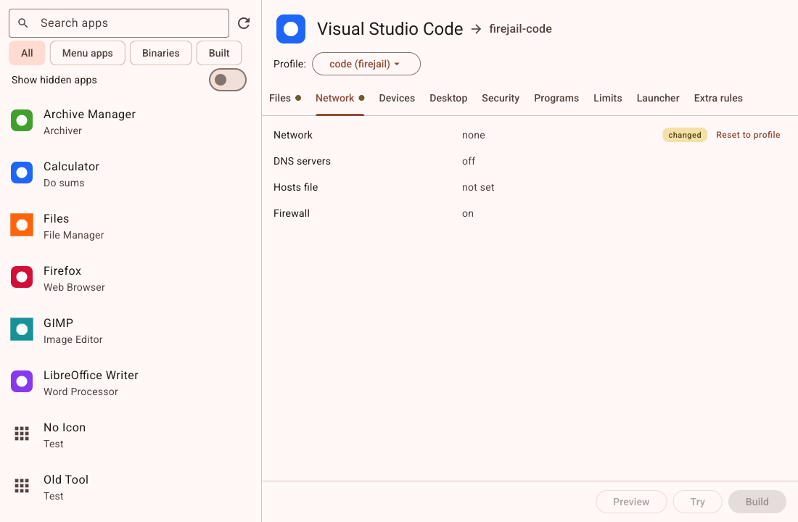
  A new VS Code build on "code (firejail)": header, profile button, nine tabs with dots on Files and Network, Network none marked changed with Reset to profile, Preview/Try/Build disabled; viewed by the manager.
  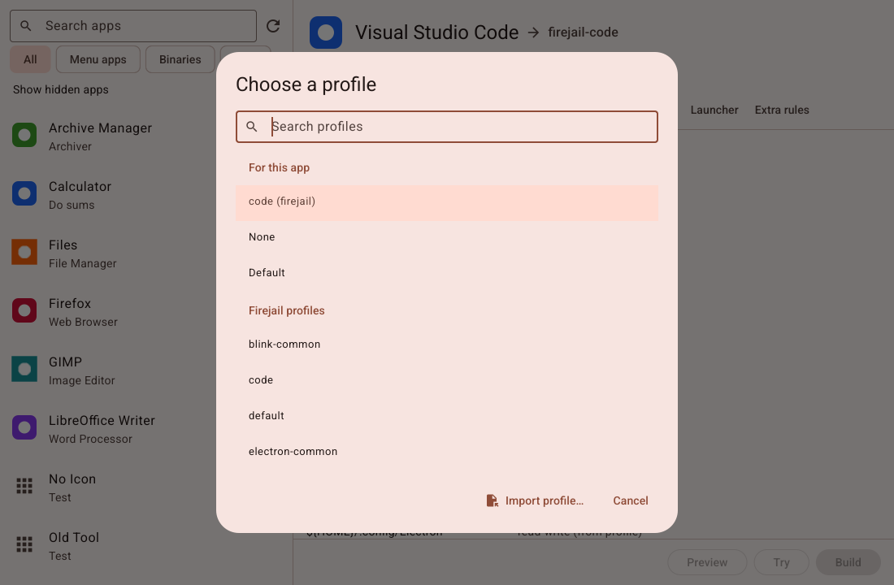
  The "Choose a profile" dialog with search, For this app (code, highlighted), None, Default and the firejail profiles, Import profile… and Cancel; viewed by the manager.
- **Manual checks:** none
- **Deviations and follow-ups:** a new build's launcher defaults (menu name, comment, terminal) are stored as overrides but don't count as changes; the sandbox name and icon seed never do. "Start over" keeps the sandbox name, icon seed and Extra rules (SPEC §6.1 updated). Never-built builds show "draft" (SPEC §5 updated). `Problems()` doesn't yet include Extra-rules diagnostics (step 4.6).

## 4.3 Files tab

- **Date:** 2026-10-27
- **Branch:** feat/step-4.3-files-tab
- **Summary:** The Files tab of SPEC §7.1: the four home choices at the top (Own private home shows its folder), the folder list (Add folder… through the desktop's folder chooser, Type a path…, access per row, remove and restore, "from profile" and locked rows, per-row Reset), the real-home refusal in Empty and Own private home, and the six quick switches. All edits go through the `Editor`, so dots, marks and drafts work.
- **Main files:** `internal/ui/filestab.go`, `pathdialog.go`, `editor_files.go`, their tests; `editor.go`, `tabs.go`, `editorpage.go`, `backend.go` (`HomesDir`).
- **Tests:** `Editor` folder operations (spellings, checks, refusals, locked rows); widget tests for every home choice, the chooser (two folders, duplicate, cancel, failure), the typed path, access, remove/restore, locked rows, every switch, Downloads disabled in private modes, scrolling; golden `files-tab`.
- **Checks:** gofmt ✅ · go vet ✅ · golangci-lint ✅ · go test -race ✅ · firejail tests none · display tests none
- **Proof:**
  
  VS Code on "code (firejail)" with Own private home chosen (its folder shown), an added `/mnt/projects`, `~/.config/Code` changed to read-only and the other profile rows; viewed by the manager.
- **Manual checks:** none
- **Deviations and follow-ups:** Own private home stores the absolute `<homes>/<sandbox name>`; renaming the sandbox in the Launcher tab must move it (step 4.6). The home folder itself can't be a row. The user's rows are listed before the profile's.

## 4.4 Network, Devices and Desktop tabs

- **Date:** 2026-10-27
- **Branch:** feat/step-4.4-network-devices-desktop
- **Summary:** The Network (Full/None, up to four DNS servers, hosts file through the chooser, firewall), Devices (nine checkboxes, checked = allowed) and Desktop (session D-Bus Full/Filtered/None with the five checkboxes and further talk/own names, system D-Bus, X11 isolation limited to installed programs) tabs of SPEC §7.2–§7.4, on shared tab helpers that the Files tab now uses too.
- **Main files:** `internal/ui/networktab.go`, `devicestab.go`, `desktoptab.go`, `stringlist.go`, `tabparts.go`, their tests; `filestab.go` (moved onto the helpers), `backend.go`/`localbackend.go` (`ProgramOnPath`).
- **Tests:** every control sets its field with dot, mark and Reset; disabled states and reasons; DNS and D-Bus name validation; X11 availability; the hosts file through the fake chooser; a base that filters the system bus; goldens `network-tab`, `devices-tab`, `desktop-tab` (and `editor` regenerated, viewed).
- **Checks:** gofmt ✅ · go vet ✅ · golangci-lint ✅ · go test -race ✅ · firejail tests none · display tests none
- **Proof:**
  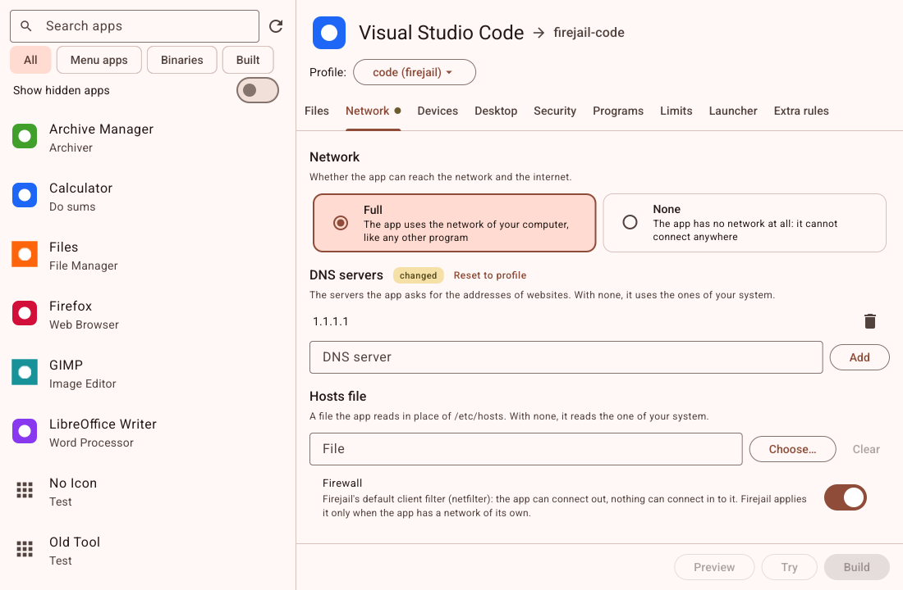
  Network Full, one DNS server added (changed, Reset), the hosts file field, the firewall switch with its namespace note; viewed by the manager.
  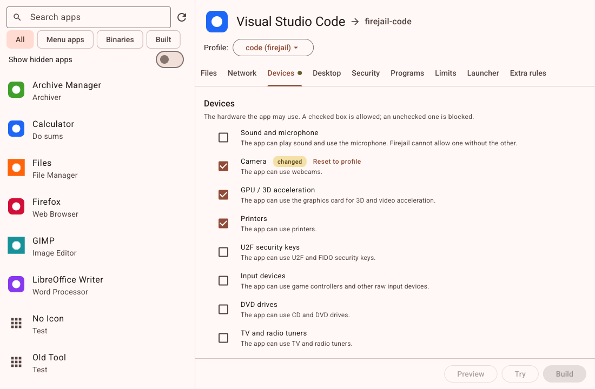
  The device checkboxes with VS Code's profile values and Camera allowed (changed, Reset); viewed by the manager.
  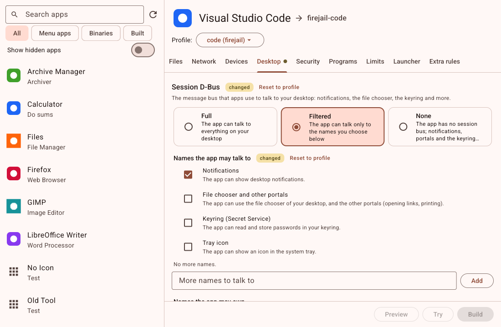
  Session D-Bus Filtered with Notifications checked and the further-names list; viewed by the manager.
- **Manual checks:** none
- **Deviations and follow-ups:** from `man firejail`: the firewall applies only with a network namespace of the sandbox's own, the X11 modes need one to close the abstract socket, and D-Bus filtering leaves abstract sockets reachable; Jailcat creates no namespace, so the fields say so (SPEC §7.2, §7.4 updated). `ProgramOnPath` takes a `ctx`. D-Bus names are checked more strictly in the UI than in `Validate`.

## 4.5 Security, Programs and Limits tabs

- **Date:** 2026-10-27
- **Branch:** feat/step-4.5-security-programs-limits
- **Summary:** The Security (seven switches, socket types with a "not restricted" state, the JIT warning, a note for Electron/Chromium bases), Programs (Only these programs and /etc files as lists, environment variables, extra arguments shown as they will be quoted) and Limits (memory with MB/GB, CPU cores of this machine, priority, time limit, open files, processes) tabs of SPEC §7.5–§7.7.
- **Main files:** `internal/ui/securitytab.go`, `programstab.go`, `limitstab.go`, their tests; `tabparts.go`, `stringlist.go` (`Display`), `backend.go`/`localbackend.go` (`CPUCount`).
- **Tests:** every control sets its field with dot, mark and Reset; the protocol states and the last-checkbox rule; list validation and duplicates; units, ranges and `hh:mm:ss`; CPU counts; goldens `security-tab`, `programs-tab`, `limits-tab`.
- **Checks:** gofmt ✅ · go vet ✅ · golangci-lint ✅ · go test -race ✅ · firejail tests none · display tests none
- **Proof:**
  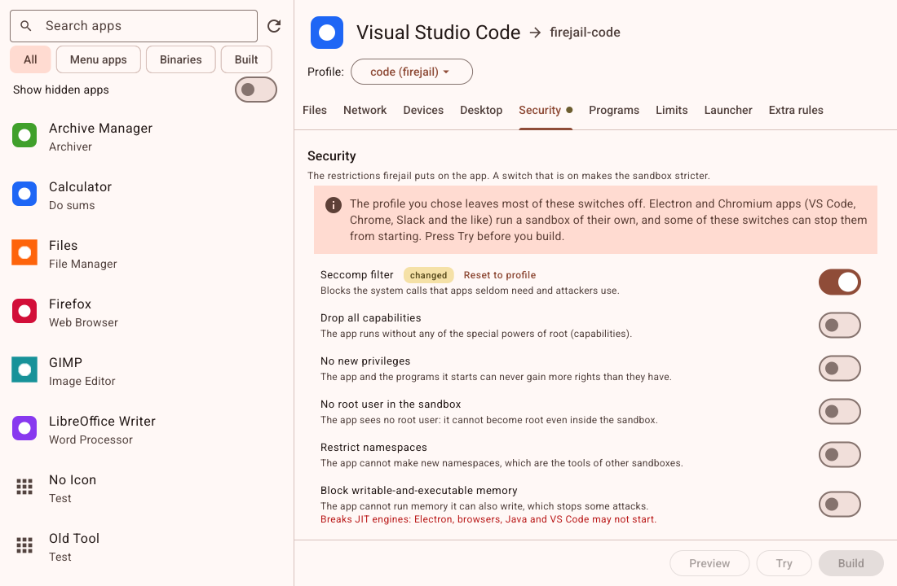
  VS Code's Security tab with the Electron note, seccomp turned on (changed, Reset) and the JIT warning; viewed by the manager.
  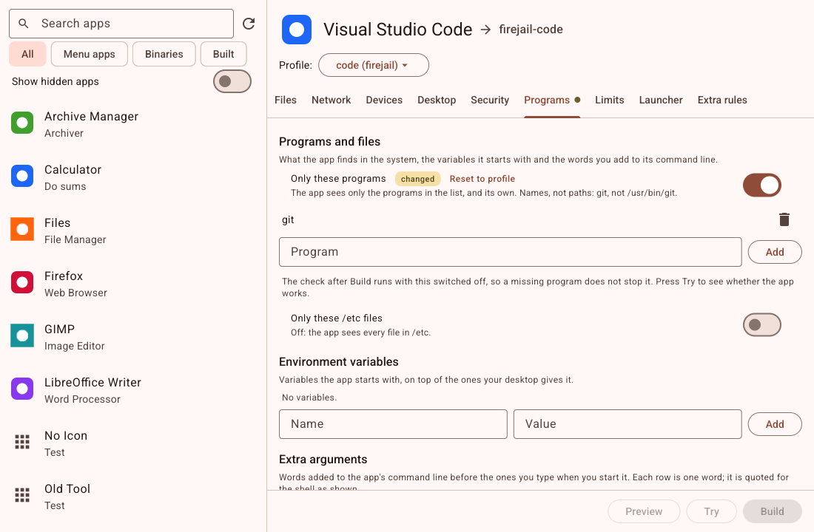
  Only these programs on with `git`, the build-check note, environment variables and extra arguments; viewed by the manager.
  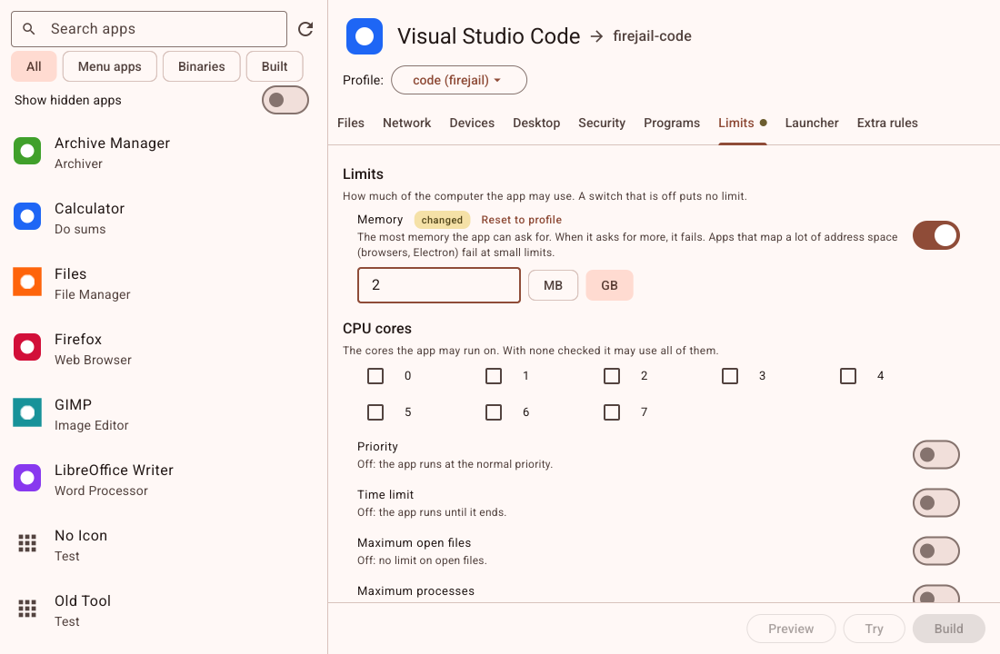
  Memory 2 GB (changed, Reset), eight CPU core checkboxes, the other limits off; viewed by the manager.
- **Manual checks:** none
- **Deviations and follow-ups:** turning a limit on starts it at a sensible value (1 GB, priority 10, 1 hour, 1024 files, 256 processes) so the model is never on-but-empty. MB/GB are powers of 1024, as firejail's suffixes. The goldens show the top of each tab; the lower controls are covered by widget tests.

## 4.6 Launcher and Extra rules tabs

- **Date:** 2026-10-27
- **Branch:** feat/step-4.6-launcher-extra-rules
- **Summary:** The Launcher tab of SPEC §7.8 (sandbox name checked for format and uniqueness, renaming moving a default private home, menu name, comment, badge or random icon with a live preview made by the same `install.RenderIcon` that Build uses, the install and behaviour switches, the bin-folder note) and the Extra rules tab of §7.9 (a numbered monospace editor checked off the UI thread with row-numbered warnings and errors, errors blocking Build through `Editor.Problems()`, and the base profile's uncovered lines grouped by file, virtualized, with false conditionals marked).
- **Main files:** `internal/ui/launchertab.go`, `extrarulestab.go`, `editor_launcher.go`, their tests; `internal/install/prepare.go` (`RenderIcon`); `backend.go`/`localbackend*.go` (`SandboxNameTaken`, `PreviewIcon`, `CheckExtraRules`); `go.mod`, `CLAUDE.md` (test fonts).
- **Tests:** every launcher control; renames with and without a base `PrivateDir`; preview in both modes with the fallback reason; Extra rules problems, stale checks ignored, groups collapsing, a 3,000-line group virtualized; `LocalBackend` tests for the three methods; route tests; goldens `launcher-tab`, `extra-rules-tab`, `extra-rules-groups`.
- **Checks:** gofmt ✅ · go vet ✅ · golangci-lint ✅ · go test -race ✅ · firejail tests none · display tests none
- **Proof:**
  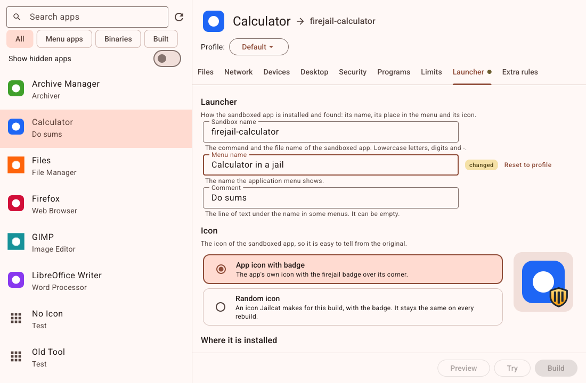
  Calculator's Launcher tab: sandbox name, a changed menu name, the comment, badge mode with the 96 px preview of its icon and the badge; viewed by the manager.
  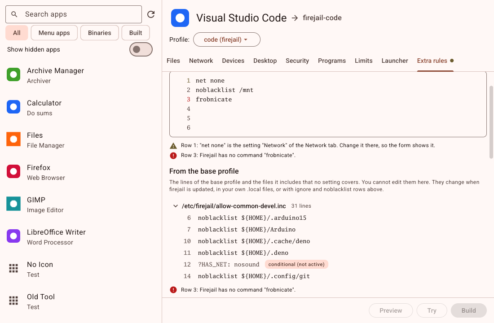
  VS Code's Extra rules with a warning on row 1 (`net none` belongs to the Network tab) and an error on row 3, and the first base-profile group open with a conditional line; viewed by the manager.
- **Manual checks:** none
- **Deviations and follow-ups:** the widget tests use the Go Mono font from `golang.org/x/image` (already in the module graph through Glutter; CLAUDE.md updated) so goldens are the same on every machine. Rows are checked on every keystroke with a sequence number instead of a debounce. Long rows wrap and their numbers drift (Glutter's text field always wraps). Step 4.7 must re-check Extra rules before Build when `ExtraRulesChecked()` is false. SPEC §7.8 updated for renames.

## 4.7 Preview, Try, Build and Uninstall

- **Date:** 2026-10-27
- **Branch:** feat/step-4.7-preview-try-build
- **Summary:** The editor's four buttons work (SPEC §11, §13). Preview shows the profile, launcher and desktop entry with the lines from settings, ignores and Extra rules highlighted. Try runs the sandbox from a temporary profile in a panel with streamed output and Stop, one at a time, stopped on app switch, editor close and window close. Build generates, checks conflicts (a dialog to overwrite what may be overwritten, or choose another name), stores a new build first so every header carries its real ID, installs, removes a renamed build's old files, records the files and runs the check, showing the result in a banner. Uninstall removes recorded files, can keep the settings and delete the private home, and asks about edited files. Rows and the editor show "firejail updated" and "base profile missing".
- **Main files:** `internal/ui/build_types.go`, `localbackend_build.go`, `editor_build.go`, `trycontroller.go`, `trypanel.go`, `previewdialog.go`, `conflictsdialog.go`, `uninstalldialog.go`, `buildflow.go`, `editorpage_actions.go`, `buildoutcome.go`, `marks.go`, their tests, `firejail_test.go`; `docs/SPEC.md` §13.2.
- **Tests:** widget tests for every flow with a fake backend (buttons, Preview, every conflict kind, check warnings, Try streaming and stopping, Uninstall with Force and Leave, the marks); `LocalBackend` tests with a fake firejail (real build IDs in headers, rebuild, rename, conflicts, failed first build leaves no row, uninstall cases, Try with a private home); route tests through the new methods; goldens `preview-dialog`, `conflicts-dialog`, `editor-built` (14 existing goldens changed only in the enabled button bar, checked by the worker with a pixel diff and by the manager by eye).
- **Checks:** gofmt ✅ · go vet ✅ (with and without the tag) · golangci-lint ✅ (with and without the tag) · go test -race ✅ · firejail tests ✅ (all of `internal/firejail`, `internal/install` and `internal/ui`, run by the manager outside Claude Code's sandbox: a build through `LocalBackend` hides the chosen folder and leaves only `lo`, Try and Stop work) · display tests none
- **Proof:**
  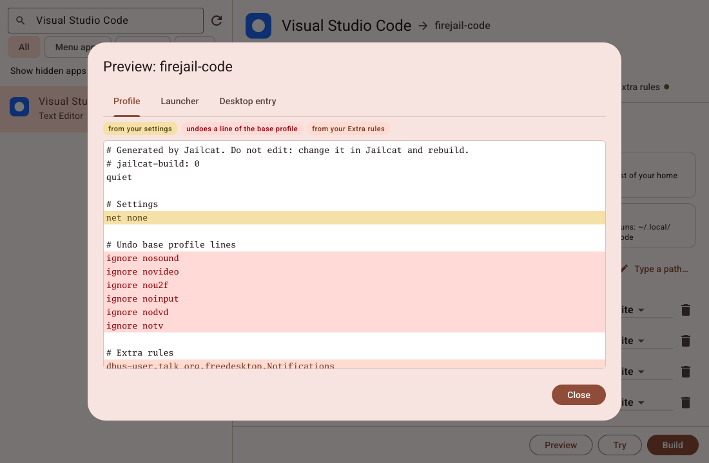
  The Preview of a VS Code build: `net none` highlighted as a setting, the `ignore` lines as undone base lines, the Extra rule marked; viewed by the manager.
  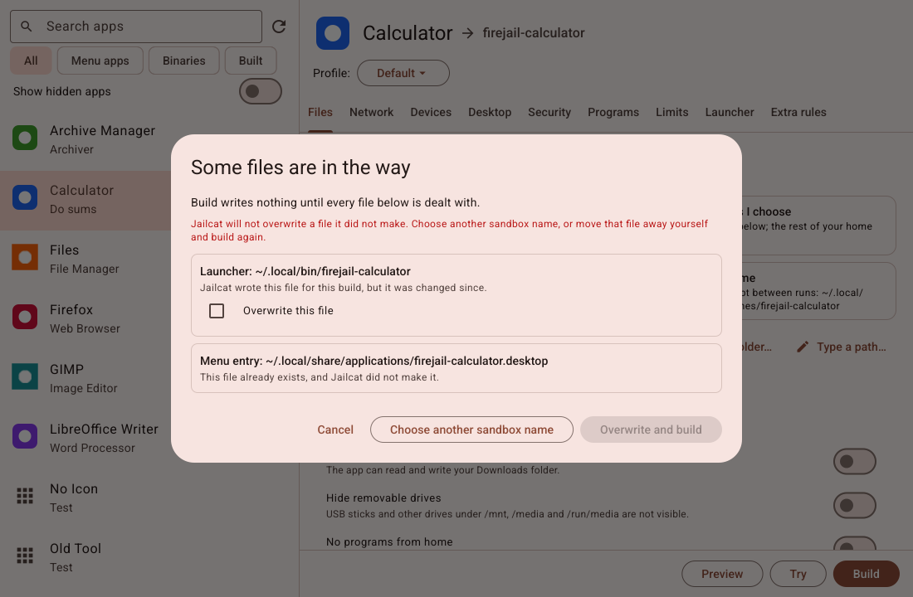
  "Some files are in the way": an edited launcher that may be overwritten and a foreign menu entry that won't be; viewed by the manager.
  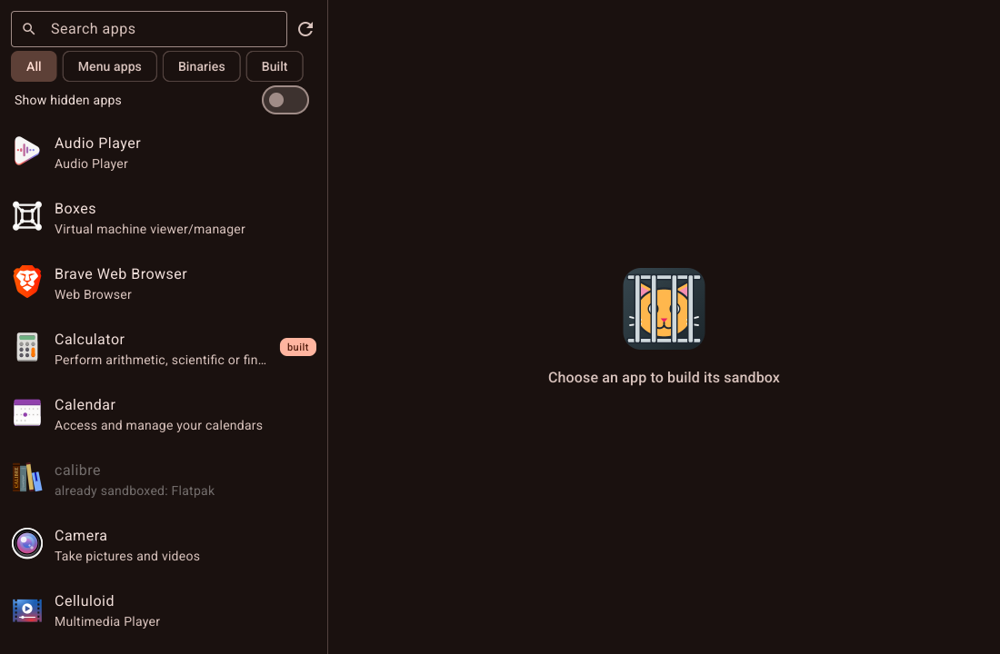
  The real app on a scratch home after a real `LocalBackend` build of Calculator (with a fake firejail in the scratch home): Calculator shows "built"; viewed by the manager.
- **Manual checks:** none
- **Deviations and follow-ups:** a new build's Preview shows `jailcat-build: 0` until it is stored; Build regenerates with the real ID. Only installed builds count as "built"; one uninstalled with its settings kept shows "draft" (SPEC §13.2 updated). Build and Uninstall finish even if the page goes away. A failed first Build deletes its new row; partly written files then show as overwritable Jailcat files.

## 5.1 Release 1.0

- **Date:** 2026-10-28
- **Branch:** feat/step-5.1-release
- **Summary:** Jailcat 1.0: the README (what it does, install with `go install` and `-setup-desktop`, how a build works, the four files it writes, development), and Glutter upgraded from v1.9.0 to v1.9.4 (fixes only: gestures, keyboard, memory leaks, the UI-goroutine check, long lists). Released as `v1.0.0`.
- **Main files:** `README.md`, `go.mod`, `go.sum`.
- **Tests:** the whole suite on Glutter v1.9.4; every golden image still matches.
- **Checks:** gofmt ✅ · go vet ✅ · golangci-lint ✅ · go test -race ✅ · firejail tests **not run on this commit**: this session ran inside Claude Code's sandbox, where firejail refuses to sandbox and the tests fail on purpose. They last passed in full on step 4.7 (Glutter v1.9.0); the Glutter upgrade changes only the window, not what a build writes · display tests none
- **Proof:** none (the user-desktop screenshots `5.1-menu.png` and `5.1-running.png` were not taken)
- **Manual checks:** **not done.** The owner asked to publish once the work was finished (2026-10-28) before doing the step's manual checks on the real desktop (menu entry and icon, the running sandboxed VS Code with its taskbar grouping, `firejail-code` from bash, Uninstall removing the entry). They remain to be done on the released version.
- **Deviations and follow-ups:** run `go test -tags jailcat_firejail ./...` outside a sandbox on this release, and the manual checks above; a fix found by either goes into a 1.0.x patch.
